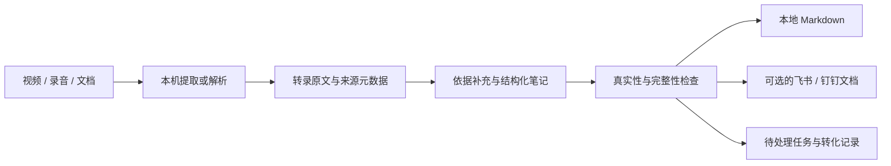

# Media Notes Workbench（多媒体笔记工作台）

<p align="center">
  <strong>把视频、会议录音和文档，变成带原文依据的笔记、决策和待办。</strong>
</p>

<p align="center">
  本地优先，保留源文件、转录原文、来源信息和处理记录；需要时再同步到飞书或钉钉。
</p>

<p align="center">
  <a href="https://github.com/guangquan123/media-notes-workbench/releases/download/v2026.09.20/Media-Notes-Workbench-2.2.6-Setup.exe">下载 Windows 安装包</a>
  ·
  <a href="https://github.com/guangquan123/media-notes-workbench/releases/tag/v2026.09.20">查看当前版本</a>
  ·
  <a href="#构建-windows-安装包">构建 Windows 安装包</a>
</p>

<p align="center">
  <a href="https://github.com/guangquan123/media-notes-workbench/releases"></a>
  <a href="https://github.com/guangquan123/media-notes-workbench/commits/sprint/default"></a>
  
  
</p>

> 这是一个个人 / 本地内容工具。它不会把无法确认的信息伪装成事实，也不会自动替你向外部平台发布内容。

## 适合谁

- 整理会议、培训、访谈和课堂录音，提取决策、重点和行动项。
- 把收藏的 B 站、抖音或本地课程视频变成可复习的学习笔记。
- 从 PDF、Word、PowerPoint 中提取结构化内容，并保留来源边界。
- 希望保留原文和处理记录，而不是只得到一篇无法核对的摘要。

## 你会得到什么

一份典型结果同时包含：

- **原文**：转录或文档解析结果，保留资料类型、标题和来源信息。
- **结构化笔记**：重点、事实、案例、风险、结论、决策或待办。
- **质量提示**：数字、术语、冲突和无法确认的内容会标记为待核对。
- **可继续处理的资产**：本地 Markdown、历史记录、提示词快照，以及可选的飞书 / 钉钉文档和待办。

它关注的不是“生成一篇看起来完整的总结”，而是让结论能回到输入资料，让每次处理都能复盘，并能继续转化为行动。

## 选择一个入口

| 你的资料                  | 入口                | 主要结果                                   |
| ------------------------- | ------------------- | ------------------------------------------ |
| B 站或抖音视频链接        | 视频学习笔记        | 转录原文、学习笔记、可选关键画面和归档结果 |
| 课程、讲座或录屏文件      | 本地视频笔记        | 音轨提取、转录、笔记和原文归档             |
| 会议视频 + 独立录音       | 双源会议 / 培训笔记 | 时间对齐、双路转写、冲突清单和融合笔记     |
| PDF、Word 或 PowerPoint   | 文档笔记            | 多文件解析、来源边界和结构化笔记           |
| 已有 MP3、M4A、WAV 等音频 | 录音整理            | 原文、重点、决策和行动项，并保留源录音     |

录音业务还支持实时录制、试听、重命名、下载、归档和重新发起处理。手机里收藏的视频链接，也可以通过[飞书收集箱](#从手机收集视频链接)自动去重并创建任务。

## 为什么不同于普通 AI 总结

| 普通摘要                   | Media Notes Workbench                           |
| -------------------------- | ----------------------------------------------- |
| 只交付一篇成稿             | 同时保留原文、笔记、来源和处理记录              |
| 事实是否来自资料不易判断   | 结论回到转录 / 解析原文，冲突和不确定性显式标记 |
| 外部发布和生成过程混在一起 | 先生成本地结果，飞书 / 钉钉同步按需启用         |
| 模板变化后难以解释旧结果   | 保存生成时使用的提示词版本和快照                |

## Windows 快速开始

### 1. 安装

直接下载当前 Windows 安装包：

**[Media-Notes-Workbench-2.2.6-Setup.exe](https://github.com/guangquan123/media-notes-workbench/releases/download/v2026.09.20/Media-Notes-Workbench-2.2.6-Setup.exe)**

安装版会把运行数据写入 `%LOCALAPPDATA%\MediaNotesWorkbench\`，不会把数据库、上传文件或进程状态写回代码目录。目录结构和迁移说明见[本地运行目录说明](docs/runtime-data-layout.md)。

### 2. 完成最小配置

首次打开应用后，按“参数配置”中的就绪检查选择当前用途：

- **文档笔记**：不需要 `ffmpeg`、`yt-dlp` 或语音转录引擎。
- **本地视频 / 录音**：需要 `ffmpeg`，并选择一种可用的转录方式，例如本地 Whisper、腾讯云 ASR 或已配置的 API 模型。
- **平台视频链接**：在本地视频能力之外，还需要 `yt-dlp`；受限视频可能需要本机浏览器登录态。
- **总结模型**：按当前运行模式配置可用的总结模型。就绪检查会显示具体缺少项，不要求先配置无关组件。

外部连接器不是首次使用的必需项。Windows 本地模式可以先把结果保存为本地 Markdown；需要同步到飞书或钉钉时，再单独完成授权和写入测试。

### 3. 生成第一份笔记

1. 选择资料入口，粘贴链接或上传文件。
2. 选择学习笔记或会议纪要模板，提交任务。
3. 在任务结果中打开原文和笔记，核对结论、数字、术语与行动项。

处理完成后，原文、笔记、提示词快照和处理状态都可以在“转化记录”中复盘；本地 Markdown 结果可以查看和下载。

<details>
<summary>版本信息与校验值</summary>

- 当前版本：`v2026.09.20`
- 应用版本：`2.2.6`
- SHA-256：`18d985d9fde14d937953992d92086ac8db9618239581c185a0a7461e194c180f`
- 本版本修复本地模式外部 AI 长文本生成连接中断，优先使用流式响应，并兼容不支持流式的模型服务。

</details>

## 处理闭环



质量控制和人工复核是闭环的一部分，不是生成失败后的补救措施。

## 支持的资料与边界

| 能力            | 输入限制                                                       | 关键边界                                                         |
| --------------- | -------------------------------------------------------------- | ---------------------------------------------------------------- |
| 录音整理        | MP3、M4A、WAV、AAC、FLAC、OGG；单个或累计不超过 10 GB          | 本地 Whisper 使用 CPU 时，长音频需要更长处理时间                 |
| 本地视频笔记    | 最多 10 个文件，单个或累计不超过 10 GB                         | 需要 `ffmpeg` 和一种可用的转录方式                               |
| 双源会议 / 培训 | 一份主视频 + 一份辅助录音，累计不超过 10 GB                    | 自动对齐不可信时会停止融合；辅助录音不能恢复原视频丢失的画面细节 |
| 文档笔记        | PDF、Word、PowerPoint；最多 10 个文件，单个或累计不超过 200 MB | 扫描件、加密文件和复杂排版可能需要 OCR 或人工复核                |
| 平台视频        | B 站、抖音视频链接                                             | 受限视频可能需要本机浏览器登录态，下载能力受平台变化影响         |

所有远程资料必须使用安全的 HTTPS 地址，禁止私网或 `localhost` 地址；只处理你有权访问、处理和保存的资料。

## 使用方式

### 录音业务

1. 打开“实时录音”，完成麦克风准备后开始、暂停或结束录制。
2. 在“录音记录”中试听并确认声音完整，可以重命名、下载或归档源录音。
3. 对需要沉淀的录音选择“转写并生成笔记”；已有音频文件可通过“录音整理”导入。
4. 在“转化记录”中查看原文、笔记、提示词快照和处理状态，必要时重新处理。

### 笔记处理

1. 在“参数配置”中完成模型服务与转录的就绪检查。
2. 按资料类型选择视频学习笔记、本地视频笔记、双源会议 / 培训笔记或文档笔记。
3. 粘贴视频地址或上传文件，必要时选择学习笔记或会议纪要模板。
4. 观察下载、解析、转录、生成、检查和归档阶段。
5. 完成后打开原文、笔记和待处理任务，人工核对关键事实。

### 双源会议 / 培训笔记

主视频负责画面和视频音轨，辅助录音补足语义。系统分别转写两路内容，根据声音能量变化计算时间偏移，并将重叠片段标记为“双路一致”；只在一路出现的内容保留来源标记，数字、术语或表述冲突会标记为“待核对”。

### 文档笔记

文档入口不依赖本地 Whisper。系统解析 PDF、Word 或 PowerPoint，并在原文和笔记中保留每个来源文件的名称、边界和指纹。

## 从手机收集视频链接

1. 在飞书创建一个仅自己使用的群聊，例如“媒体收集箱”。不要把它用于多人聊天，因为该会话中的每条 B 站或抖音链接都会进入处理队列。
2. 在电脑端打开“飞书收集箱”，填写该会话的 `oc_...` ID 并绑定。可用以下命令查询会话：

   ```bash
   lark-cli im +chat-search --as user --query 媒体收集箱 --format json
   ```

3. 绑定时已有消息只作为基线，之后的新链接才会进入队列。服务每 30 秒检查一次，也可以在页面手动同步。
4. 任务结果仍在“视频学习笔记”和“转化记录”中查看。

绑定信息和已处理消息 ID 只保存在本机运行目录的 `config/.media-inbox-state.json`，电脑需要保持本机服务和飞书 CLI 授权状态。

## 构建 Windows 安装包

在 Windows **命令提示符（CMD）**中运行：

```bat
cd /d D:\data\codex_space\media-notes-workbench\
build-windows-installer.cmd
```

如果源码位于其他目录，请将第一行替换为实际路径。构建前需准备 Node.js 22（含 npm）、项目依赖和 Inno Setup 编译器。

构建成功后，安装包位于 `release\windows\<版本号>\installer\` 目录，运行生成的 `Setup.exe` 安装程序即可安装。

## 可追溯性与数据边界

- **输入可回溯**：转换记录保存资料类型、标题、结果状态，并提供原文入口。
- **提示词可回溯**：每次生成记录提示词快照和版本，避免模板变化后无法解释旧笔记。
- **来源有边界**：主体内容应来自转录或解析原文、资料元数据和明确带来源 URL 的补充材料。
- **外发可选择**：本地 Markdown 可以先完成；启用云端 ASR 或外部总结模型时，相应内容会发送给对应云服务。
- **人工在闭环中**：转录质量、AI 输出、外部补充、图片版权、隐私和最终分享都需要人工检查。
- **权限不越界**：飞书和钉钉一次只启用一个连接器，输出位置和待办权限以当前授权为准。

## 常见问题

| 现象                             | 优先检查                                                                                                  |
| -------------------------------- | --------------------------------------------------------------------------------------------------------- |
| 平台视频下载失败或 B 站 HTTP 412 | 链接是否有效；是否选择了已登录浏览器作为 Cookie 来源；`yt-dlp` 是否可用                                   |
| 转录无法开始                     | `ffmpeg`、可用的转录引擎和本地模型，或腾讯云 ASR / API 模型配置                                           |
| 无法创建飞书文档或待办           | `lark-cli auth status --json --verify`，以及当前账号对目标位置的权限                                      |
| 无法写入钉钉文档或待办           | `dws auth status --format json`，以及执行人配置                                                           |
| 文档笔记很少或不完整             | 源文件是否为扫描件、加密文件或复杂排版；必要时先 OCR 并人工核对                                           |
| 修改提示词后样式未变化           | 保存后还要点击“发布生效”；草稿不会直接用于新任务                                                          |
| 本地模式长文本生成连接中断       | 升级到最新版本后重试；检查网络、代理和模型服务状态。当前版本优先使用流式链路，并兼容不支持流式的 Provider |
| 历史记录找不到                   | 清除类型、日期和状态筛选；记录按生成时间倒序展示                                                          |
| 本地页面打不开                   | 查看 `logs/dev.std.log`，确认 `3000`、`8081` 端口属于本项目                                               |

## 当前边界

- 异步任务暂不具备服务重启恢复、队列调度、阶段重试和完整并发控制。
- 本地 Whisper 使用 CPU；长视频和大文件需要较长处理时间。
- 笔记质量受源文件、转录和文档解析质量影响；专业术语、数字、代码和图表需要重点复核。
- 不自动向外部平台发布内容，也不跟踪外部平台发布结果。

运行中的任务状态保存在服务进程内存中，服务重启后尚未完成的任务不能继续查询；转换历史、提示词版本和追溯数据使用项目数据库保存。

## 开源协议

本项目采用 [MIT License](LICENSE) 开源。你可以在保留许可声明的前提下自由使用、修改、分发与二次开发。项目依赖的第三方库、模型和外部工具仍受其各自许可证约束。
